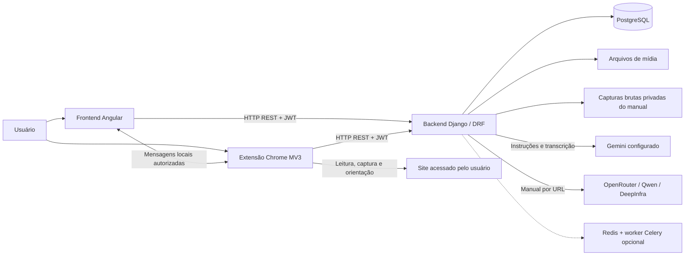

# OCTOR — documentação técnica consolidada

Atualização: **6 de novembro de 2026**. Documento baseado nos arquivos do projeto local, não apenas no planejamento do produto. Credenciais, capturas e dados de usuários não fazem parte desta documentação.

Atualização posterior à consolidação: [Quiz obrigatório e ranking](QUIZ-OBRIGATORIO.md). Novas versões publicadas exigem cinco perguntas, datas separadas para conteúdo/quiz e estrelas antes da conclusão. Versões já iniciadas preservam o fluxo anterior.

Atualização de rastreabilidade: [Versionamento e auditoria](VERSIONAMENTO-E-AUDITORIA.md) descreve snapshots, cópias privadas de mídia, eventos e versão do sistema.

## 1. Visão e escopo

O OCTOR é uma plataforma web de documentação e orientação de processos. Criadores registram ações em sistemas web, revisam instruções e capturas e compartilham guias reutilizáveis. Executores consultam os procedimentos e podem receber treinamentos com acompanhamento de conclusão e avaliação.

Há dois caminhos de criação: gravação de ações pelo usuário e coleta de uma página por URL. O segundo é um piloto de leitura: não é um agente que percorre o sistema autonomamente. O projeto também oferece edição, narração, biblioteca pessoal, equipes, notificações e orientação dentro do site por meio da extensão.

## 2. Arquitetura



Frontend e extensão possuem sessões próprias e consomem a mesma API. A ponte web/extensão é restrita às origens locais configuradas no manifest. O backend do manual não baixa a URL fornecida: recebe as evidências coletadas no navegador. As chamadas de IA são feitas pelo servidor.

### Organização

| Caminho | Responsabilidade |
| --- | --- |
| `front/` | Aplicação Angular, telas, serviços HTTP, guards e tema |
| `back/accounts/` | Conta, JWT, Google, configurações e notificações |
| `back/guides/` | Guias, passos, equipes, compartilhamentos e convites |
| `back/trainings/` | Publicação do treinamento, participações, feedback e indicadores |
| `back/manuals/` | Coleta por URL, imagens privadas, análise e revisão do manual |
| `back/ai/` | Geração de instruções e tratamento da narração |
| `back/videos/` | Registro de tarefas de vídeo; processamento atualmente simulado |
| `back/config/` | Settings, rotas centrais, WSGI e configuração Celery |
| `extensao/` | Captura, microfone auxiliar, Me guie e ponte com a web |
| `docs/` | Documentação técnica e funcional |
| `scripts/` e `design-tokens.json` | Geração e definição do tema compartilhado |

## 3. Stack e versões

| Tecnologia | Versão ou faixa verificada | Uso |
| --- | --- | --- |
| Python | 3.13.14 no ambiente inspecionado | Backend e comandos de gestão |
| Django | `>=5.1,<6.0` | ORM, migrations, autenticação e HTTP |
| Django REST Framework | `>=3.15.0` | Serializers, permissões e API |
| SimpleJWT | `>=5.3.1` | Tokens de acesso e renovação |
| PostgreSQL / psycopg | Driver `>=3.2.0`; Compose define PostgreSQL 16 | Banco obrigatório |
| Angular | `^19.0.0` | SPA com componentes standalone |
| TypeScript / RxJS | `~5.6.2` / `~7.8.0` | Tipos e fluxos assíncronos |
| Node.js | 24.21.0 no ambiente inspecionado | Ferramentas, build e testes JavaScript |
| Chrome | Mínimo 116; extensão 1.2.0 | Manifest V3 e painel lateral |
| Celery / Redis | `>=5.4.0` / cliente `>=5.0.0` | Infraestrutura de tarefas opcionais |
| Pillow / requests | `>=10.4.0` / `>=2.32,<3` | Imagens e chamadas HTTP |
| google-auth / python-dotenv | `>=2.38,<3` / `>=1.0.1` | Identidade Google e ambiente local |

As versões do runtime inspecionado não constituem requisitos mínimos declarados. O backend usa faixas em `requirements.txt`, sem lockfile Python. O frontend utiliza `package-lock.json` e `npm ci`. Para decisões e limitações de cada tecnologia, consulte [STACK.md](STACK.md).

## 4. Instalação local

### Pré-requisitos

Disponibilize Python compatível com as dependências, Node/npm, Chrome e um banco PostgreSQL. A pasta local atual é `D:\PROJETO OCTOR`. Execute os comandos abaixo na raiz do projeto, em terminais PowerShell separados quando indicado.

### Backend

```powershell
cd "D:\PROJETO OCTOR"
python -m venv back/venv
back/venv/Scripts/python.exe -m pip install -r back/requirements.txt
# Faça a cópia somente se o arquivo local ainda não existir.
Copy-Item back/.env.example back/.env
```

Antes de executar migrations, crie o banco PostgreSQL e preencha o `.env`. Se o ambiente virtual já existe e funciona, não é necessário recriá-lo. Não sobrescreva seu `.env` existente. Use o interpretador diretamente, pois ambientes virtuais movidos podem conter atalhos para o caminho antigo.

```powershell
back/venv/Scripts/python.exe back/manage.py migrate
back/venv/Scripts/python.exe back/manage.py createsuperuser
back/venv/Scripts/python.exe back/manage.py runserver 8000
```

### Frontend

Em outro terminal:

```powershell
cd "D:\PROJETO OCTOR\front"
npm ci
npm start
```

Abra `http://localhost:4200`. A API local é `http://localhost:8000`; o painel Django fica em `http://localhost:8000/admin/`.

### Extensão

1. Abra `chrome://extensions` e ative o modo do desenvolvedor.
2. Use **Carregar sem compactação** e selecione `D:\PROJETO OCTOR\extensao`.
3. Abra o painel pelo ícone do OCTOR e conecte sua conta.
4. Depois de atualizar os arquivos, recarregue a extensão e as páginas onde ela será usada.

### Redis e worker opcionais

O Compose atual provisiona apenas PostgreSQL e Redis, não a aplicação inteira. Para iniciar somente Redis, na raiz:

```powershell
docker compose up -d redis
back/venv/Scripts/python.exe -m celery -A config worker --loglevel=info -P solo
```

O comando do worker ocupa um terminal separado. O Compose mantém nomes e credenciais legados de desenvolvimento para PostgreSQL, diferentes do `.env.example` atual. Também publica a porta 5432, que pode conflitar com PostgreSQL instalado no Windows. Revise a conexão antes de optar pelo banco do container. Esta documentação não altera nem migra esse banco.

## 5. Configuração de ambiente

Todas as variáveis abaixo pertencem ao backend. Não publique o `.env`, não inclua segredos em Angular, manifest, documentação ou logs.

| Variável | Finalidade |
| --- | --- |
| `SECRET_KEY` | Segredo Django; substituir o fallback de desenvolvimento |
| `DEBUG` | `True` somente em desenvolvimento |
| `ALLOWED_HOSTS` | Hosts aceitos, separados por vírgula |
| `DB_NAME`, `DB_USER`, `DB_PASSWORD` | Identidade e credencial do PostgreSQL |
| `DB_HOST`, `DB_PORT` | Endereço do banco; porta usual 5432 |
| `GOOGLE_CLIENT_ID` | Identificador público OAuth Web do Google |
| `LLM_PROVIDER`, `LLM_API_KEY`, `LLM_MODEL` | Provedor das instruções; configuração local mantém Gemini |
| `MANUAL_LLM_PROVIDER` | Override exclusivo do manual; `openrouter` na configuração local |
| `MANUAL_LLM_MODEL` | `qwen/qwen3-vl-30b-a3b-instruct` na integração atual |
| `OPENROUTER_API_KEY` | Credencial exclusiva do servidor para o manual |
| `CELERY_BROKER_URL`, `CELERY_RESULT_BACKEND` | Redis usado pelo Celery |

Exemplos sem segredos estão em `back/.env.example`, `back/.env.ai.example` e `back/.env.google.example`. Reinicie o processo Django depois de mudar essas variáveis. SQLite não é uma alternativa configurada no projeto.

O Google exige configurar consentimento e Client ID Web no Google Cloud e autorizar as origens da aplicação. O backend valida o ID token com desafio/nonce. Contas com mesmo e-mail não são unidas automaticamente: a vinculação é feita por um usuário autenticado. Esse fluxo não exige Client Secret no código atual; a configuração real e seu teste continuam necessários.

## 6. Modelo de dados

| Entidade | Papel e relações principais |
| --- | --- |
| `User`, `UserSettings`, `GoogleAccount` | Identidade Django, preferências/sessões e identidade Google vinculada |
| `Workspace` | Equipe com proprietário e membros |
| `Guide` | Procedimento com autor, equipe opcional, status, favoritos, lixeira e áudio |
| `Step` | Ordem, instrução, print, URL, seletor, coordenadas, metadados e narração |
| `GuideShare` | Compartilhamento direto, único por guia e destinatário |
| `WorkspaceInvitation` | Convite com hash do token, validade e estado de aceitação |
| `Notification` | Aviso interno de um destinatário, com data de leitura |
| `Training` | Treinamento baseado em um guia e vinculado ao responsável |
| `Participation` | Atribuição, início, versão e conclusão; única por treinamento e usuário |
| `Feedback` | Estrelas de 1 a 5 e comentário até 500 caracteres; único por treinamento e usuário |
| `ManualRun` | UUID, autor, URL, objetivo, estado, documento JSON e guia resultante |
| `ManualCapture` | Evidências e imagem privada; chave e ordem únicas dentro da coleta |
| `VideoJob` | Estado e progresso do pipeline simulado de vídeo |

Os modelos antigos de quiz continuam no banco para preservar histórico. Novas versões publicadas criam cinco perguntas obrigatórias; versões anteriores preservam seu contrato. A classe histórica `QuizVersion` também guarda a versão do procedimento usada pelo treinamento; o nome não indica que o quiz esteja ativo.

## 7. Fluxos principais

### Gravação e edição

A extensão observa ações do usuário, registra contexto e seletores e solicita capturas ao Chrome. A fila respeita o intervalo de captura e verifica se documento, posição e alvo continuam compatíveis. Quando não há imagem confiável, mantém o passo para revisão em vez de associar um print incorreto. Cliques muito rápidos continuam sujeitos às limitações da API de captura.

Os passos são persistidos na API e abertos no editor. O criador ajusta texto, ordenação, enquadramento, destaque e áudio. A IA pode gerar uma instrução ou processar o conjunto de passos; resultados devem ser revisados. A impressão usa `window.print()` e o layout de impressão do editor, permitindo **Salvar como PDF** pelo navegador. O nome interno `exportHtml` não representa um exportador independente de arquivo HTML; não se deve presumir exportação Markdown.

### Narração

Há gravação individual por passo e gravação durante a captura, com aba auxiliar de microfone. O áudio integral do guia possui intervalos associados aos passos; a narração individual tem prioridade sobre o trecho do guia. A transcrição e geração acontecem após a gravação, não como agente que executa ações durante a fala. O processamento de áudio pela IA tem seus próprios limites; consulte os READMEs dos módulos para os limites operacionais.

### Me guie

A web solicita à extensão a abertura da URL do procedimento. O painel procura o elemento, desenha o destaque e oferece avanço, retorno, nova tentativa e encerramento. O executor realiza as ações. O sistema não clica nem preenche formulários automaticamente. Isso não impede que o próprio usuário confirme uma operação real em produção. Elementos ambíguos ou ausentes exigem intervenção.

### Manual por URL

1. O usuário fornece URL/objetivo e autoriza a coleta e o envio das evidências à IA.
2. A ponte verifica extensão, versão do leitor e sessão antes de iniciar.
3. A extensão abre uma página e coleta até seis regiões visíveis, aguardando estabilidade.
4. O leitor reúne texto, controles e retângulos medidos; tenta mascarar valores de campos nas imagens.
5. O backend valida e deduplica as capturas e armazena os originais privadamente.
6. O adaptador envia imagens e evidências para Qwen via OpenRouter; o roteamento está fixado em DeepInfra, sem fallback para outro serviço.
7. A resposta deve respeitar JSON Schema e referências reais; formato inválido permite somente uma tentativa adicional.
8. O criador revisa seções, passos e controles destacados. Aprovar cria um guia em rascunho.

Estados relevantes: `waiting`, `capturing`, `captured`, `generating`, `review`, `approved`, `failed`, `cancelled`. Mensagens de atenção explicam interrupções da coleta. A aprovação é idempotente; não gera vários guias para a mesma coleta aprovada.

O prompt exige português, instruções fundamentadas, rótulos reais e diferenciação entre interface observada e orientação não executada. Conteúdo do site é dado não confiável. O modelo não pode inventar coordenadas ou resultados. A validação estrutural não garante a correção semântica de toda frase: a revisão humana permanece necessária.

Esse fluxo documenta **uma página por coleta**. Não percorre automaticamente outros links, não compra, não faz login nem contorna CAPTCHA. Precisa de aba/janela ativa. Guias resultantes têm passos de referência e não habilitam Me guie. Detalhes em [MANUAL-POR-URL.md](MANUAL-POR-URL.md).

### Treinamento e avaliação

O gestor publica uma versão do procedimento e atribui participantes. O participante inicia, consulta e finaliza o conteúdo, responde ao quiz obrigatório nas versões novas e envia estrelas/comentário opcional para concluir. O servidor exige conclusão antes do feedback e impede duplicidade. A administração consulta participantes e indicadores; a autorização depende da propriedade e das equipes administradas, não apenas de um botão ou guard do Angular. O superusuário Django é um conceito distinto da gestão funcional de treinamentos.

### Equipes e notificações

O proprietário gerencia membros, busca contas por nome de usuário e administra convites. Compartilhamento, alterações de membros, atribuições e manual pronto podem criar avisos internos. O usuário só acessa suas notificações; a listagem é paginada em 20 itens, com total de não lidas. A interface consulta atualizações periodicamente; não é um serviço de push ou envio de e-mail.

## 8. Catálogo resumido da API

Base local: `http://localhost:8000`. Preserve a barra final. Rotas privadas recebem `Authorization: Bearer <access_token>`. A tabela resume contratos existentes; campos e regras detalhados estão nos serializers/views indicados pelos módulos.

| Método | Caminho | Finalidade |
| --- | --- | --- |
| POST | `/api/auth/register/`, `/api/auth/login/`, `/api/auth/refresh/` | Cadastro, login e renovação |
| GET | `/api/auth/me/` | Conta autenticada |
| PATCH | `/api/auth/profile/`, `/api/auth/settings/` | Perfil e preferências |
| POST | `/api/auth/password/`, `/api/auth/sessions/revoke/` | Senha e revogação de outras sessões |
| GET | `/api/auth/google/config/` | Configuração pública do Google |
| POST | `/api/auth/google/challenge/`, `/api/auth/google/login/`, `/api/auth/google/link/` | Desafio, login e vinculação Google |
| GET | `/api/auth/notifications/` | Avisos próprios; aceita `unread=true` |
| POST | `/api/auth/notifications/{id}/read/`, `/api/auth/notifications/read-all/` | Marcar leitura |
| GET / POST | `/api/guides/` | Listar/criar guias |
| GET / PATCH / DELETE | `/api/guides/{id}/` | Consulta, edição e lixeira conforme permissão |
| POST | `/api/guides/{id}/restore/`, `/api/guides/{id}/permanent-delete/` | Restaurar ou excluir definitivamente |
| POST | `/api/guides/{id}/favorite/` | Alternar favorito |
| POST | `/api/guides/{id}/steps/`, `/api/guides/{id}/bulk-steps/` | Inserção de passos |
| GET / PATCH / DELETE | `/api/guides/steps/{id}/` | Operações por passo conforme viewset |
| GET / POST | `/api/workspaces/` | Equipes acessíveis e criação |
| GET / POST / DELETE | `/api/workspaces/{id}/members/`, `/api/workspaces/{id}/invitations/` | Membros e convites |
| GET | `/api/workspaces/{id}/user-search/` | Busca autorizada de contas |
| GET / POST | `/api/workspaces/invitations/{token}/` | Consultar/aceitar convite |
| POST | `/api/guides/{id}/generate-text/`, `/api/guides/{id}/steps/{step_id}/generate-text/` | Instruções por IA |
| POST | `/api/guides/{id}/prepare-narration/` | Preparar narração/transcrição |
| GET / POST | `/api/manuals/` | Listar/iniciar coletas próprias |
| GET | `/api/manuals/{uuid}/` | Estado, documento e metadados |
| POST | `/api/manuals/{uuid}/captures/` | Inserir captura validada |
| GET | `/api/manuals/{uuid}/captures/{id}/image/` | Imagem privada autenticada |
| POST | `/api/manuals/{uuid}/{acao}/` | `canonical`, `progress`, `attention`, `captured`, `generate`, `approve`, `cancel` |
| GET | `/api/trainings/`, `/api/trainings/{id}/` | Treinamentos atribuídos |
| POST | `/api/trainings/{id}/{acao}/` | `start`, `complete`, `feedback` |
| GET | `/api/trainings/capabilities/` | Capacidade de gestão |
| GET / POST | `/api/trainings/admin/` | Listagem/criação pelo gestor |
| GET / PATCH | `/api/trainings/admin/{id}/` | Detalhes/edição autorizados |
| POST | `/api/trainings/admin/{id}/{acao}/` | `publish`, `archive`, `assign` |
| GET | `/api/trainings/admin/{id}/participants/{user_id}/` | Inspecionar participação |
| GET | `/api/trainings/admin/dashboard/` | Indicadores autorizados |
| POST / GET | `/api/guides/{id}/video/` (POST), `/api/video-jobs/{id}/` (GET) | Pipeline simulado |

Erros usuais: 400 para entrada inválida; 401 para sessão ausente/expirada; 403 para acesso proibido; 404 para registro fora do escopo; 429 para limites de requisição. A geração trata também falhas de autenticação/crédito/limite do provedor, preservando capturas. Não há contrato OpenAPI gerado automaticamente documentado nesta entrega.

### Rotas principais da web

`/login`, `/register`, `/account`, `/guides`, `/guides/:id`, `/join/:token`, `/notifications`, `/manuals`, `/manuals/:id`, `/trainings`, `/trainings/:id`, `/training-admin`, `/training-admin/new`, `/training-admin/:id`, `/training-dashboard`.

## 9. Segurança e limitações de produção

**Existente:** senhas tratadas pelo Django; autenticação JWT com renovação e controle de versão de sessão; isolamento por propriedade/equipe nas views; validação de formulários e imagens; unicidade no banco para entidades críticas; imagens brutas do manual privadas e sem cache público; chaves de IA somente no servidor.

**Pontos que ainda exigem preparação para produção:**

- O settings atual permite CORS amplo e possui defaults de desenvolvimento para DEBUG, hosts e segredo. Definir variáveis não remove sozinho a política CORS ampla: revisar essa configuração antes de expor o servidor.
- O frontend armazena JWT em `localStorage`; prevenção de XSS e uma política de sessão apropriada são essenciais.
- Mídia de guias aprovados segue o armazenamento existente, sem a mesma proteção privada aplicada às capturas brutas do manual. Controlar downloads em produção antes de hospedar material confidencial.
- O manifest solicita acesso amplo a sites. Revisar permissões, consentimento, origens e política de distribuição da extensão.
- A ponte da extensão permite somente as origens locais configuradas; serviços Angular também contêm URLs locais. Publicar o build, sozinho, não conecta um domínio novo.
- Capturas podem conter dados pessoais. O mascaramento do Manual por URL é parcial, não uma garantia universal; a gravação comum também exige revisão dos prints.
- Envio à IA transmite evidências para terceiros. Definir provedores, tratamento/retenção dos dados e autorização compatíveis com o uso real.
- Me guie não executa ações, mas as ações do executor são reais. Preferir homologação para treinamento de operações destrutivas ou financeiras.

Não há certificação de conformidade, sandbox de produção, cópia HTML interativa isolada ou agente autônomo de navegação implementados por este módulo.

## 10. Verificação manual

Consulte o [roteiro de reconstrução](RECONSTRUCAO.md).

### Dados de demonstração

```powershell
back/venv/Scripts/python.exe back/manage.py seed_trainings --password "DEFINA-UMA-SENHA-LOCAL-FORTE"
```

O seed é restrito a `DEBUG=True`, cria equipe, guias, treinamentos, participantes e avaliações com nomes de demonstração. Não troca senhas de contas já existentes. Não é uma migração de dados reais nem deve ser executado em produção.

### Roteiro de aceitação manual

1. Cadastrar conta, entrar, editar perfil e testar permissões com uma segunda conta.
2. Gravar dois passos, revisar prints e salvar um guia. Repetir com cliques rápidos e conferir avisos.
3. Gravar narração, finalizar e conferir áudio/instruções no editor.
4. Testar Me guie em homologação, incluindo alvo ausente e troca de página.
5. Coletar uma URL autorizada, conferir até seis prints, gerar, revisar destaques e aprovar o rascunho.
6. Compartilhar um guia, adicionar membro e conferir os avisos de cada conta.
7. Publicar/atribuir treinamento, concluir como participante e tentar enviar avaliação duplicada.
8. Imprimir em PDF e conferir seções, instruções e imagens inteiras.

## 11. Operação e implantação

O repositório ainda requer preparação para hospedagem; o plano Google Cloud foi adiado. O Compose existente não é um deploy completo. Para publicar, preparar build Angular com fallback de SPA, servidor WSGI apropriado, HTTPS, URLs/origens corretas, PostgreSQL e armazenamento persistente. Executar migrations e `collectstatic` no processo de release. Se utilizar tarefas Celery, provisionar Redis e worker separadamente.

Persistir e incluir nos backups tanto PostgreSQL quanto `back/media/` e `back/private_manuals/`; backup só do banco não preserva imagens e áudios. Testar restauração e controlar o acesso aos backups. Não versionar mídia, segredos, ambientes virtuais ou dependências.

## 12. Diagnóstico rápido

| Sintoma | Verificação e ação |
| --- | --- |
| Cadastro não conclui | Conferir campos e resposta da API; verificar conexão PostgreSQL e migrations |
| Token expirado / 401 | Renovar sessão ou entrar novamente e reconectar a extensão |
| Extensão não responde | Conferir pasta `extensao`, versão 1.2.0, conta conectada e origem local; recarregar extensão e página |
| Coleta sem prints | Manter aba em primeiro plano; verificar login, CAPTCHA, modais e mensagem de atenção |
| Print ausente em clique rápido | Rever o passo; o sistema pode preservar a ação sem imagem quando não há captura confiável |
| OpenRouter sem créditos | Conferir saldo/limite no provedor; as capturas permanecem disponíveis |
| IA recusa o formato | Rever coleta e tentar novamente; não substituir IDs ou aceitar JSON incompleto manualmente |
| Google não aparece | Configurar Client ID e origens, reiniciar backend e recarregar frontend |
| Imagens somem após deploy | Verificar volume persistente e política de acesso à mídia |
| Vídeo chega a 100% sem arquivo real | Pipeline atual é simulação; falta implementar renderização |
| Porta 5432 ocupada | Escolher PostgreSQL local ou container e alinhar conexão, sem apagar volumes |

## 13. Referências internas

- [Índice da documentação](README.md)
- [Manual do usuário](MANUAL-DO-USUARIO.md)
- [Frontend](../front/README.md), [backend](../back/README.md), [extensão](../extensao/README.md)
- [Manual por URL](MANUAL-POR-URL.md)
- [PostgreSQL local](POSTGRESQL-LOCAL.md)
- [Membros e notificações](NOTIFICACOES-E-MEMBROS.md)
- [Conta e segurança](account-settings.md)
- [Treinamentos e feedback](trainings-feedback-quiz.md) — nome de arquivo histórico; nome histórico; consulte o documento do quiz obrigatório

Esta documentação registra o estado encontrado, sem alterar lógica, schema, credenciais ou dados do projeto.
