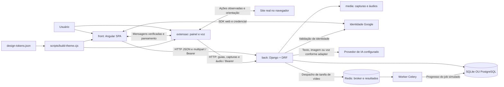

# Stack técnica — PROJETO OCTOR

Este documento descreve a implementação atual do produto **OCTOR**, organizada em `front`, `back` e `extensao`. As fontes de verdade são os arquivos de configuração, dependências e código do repositório. Instalação, comandos e endpoints estão nos READMEs de [front](../front/README.md), [back](../back/README.md) e [extensão](../extensao/README.md).

## Como interpretar as escolhas

**Não foi encontrado um histórico formal das decisões de arquitetura.** As justificativas abaixo são uma análise de adequação ao código existente. A coluna de alternativas representa uma comparação técnica proposta e autorizada durante a documentação; não afirma que a equipe avaliou e rejeitou essas ferramentas originalmente.

“Menos adequada aqui” significa maior custo de integração ou migração para os requisitos observados, e não inferioridade geral. Não foram feitos benchmarks, testes de carga ou migrações para provar superioridade. Nenhuma tecnologia foi instalada, atualizada ou substituída nesta etapa.

O inventário cobre dependências diretas, recursos nativos e ferramentas relevantes. Dependências transitivas internas do Angular/Django não são tratadas como escolhas independentes do projeto. Pacote declarado não significa funcionalidade implementada ou serviço em execução.

## Versões verificadas e reprodutibilidade

| Grupo | Declaração | Versão resolvida/observada |
| --- | --- | --- |
| Frontend | `front/package.json` e lockfile | Angular Core 19.2.25; CLI/builder 19.2.27; TypeScript 5.6.3 |
| Reatividade web | Dependências npm | RxJS 7.8.2; Zone.js 0.15.1; tslib 2.8.1 |
| Ferramentas JavaScript | Runtime local | Node.js 24.21.0; npm 11.19.0 |
| Runtime backend | Ambiente virtual local; Python não fixado no projeto | Python 3.13.14 |
| API | `back/requirements.txt` | Django 5.2.18; DRF 3.18.3; SimpleJWT 5.5.1; django-cors-headers 4.9.0 |
| Tarefas e banco | Dependências Python locais | Celery 5.6.3; cliente redis 8.1.0; psycopg 3.3.6 |
| Arquivos e HTTP | Dependências Python locais | Pillow 12.3.0; python-dotenv 1.2.4; requests 2.34.2 |
| Google | `google-auth>=2.38,<3` | Declarado, mas ausente no ambiente virtual inspecionado |
| Banco local | Biblioteca do Python inspecionado | SQLite 3.50.4 |
| Serviços auxiliares | Tags de `docker-compose.yml` | PostgreSQL `16-alpine`; Redis `7-alpine`; não comprova execução local |
| Extensão | `manifest.json` | Manifest V3; pacote 1.0.0; Chrome mínimo declarado 116 |

O lockfile npm registra versões resolvidas e é consumido por `npm ci`. O backend usa faixas no requirements, sem lockfile Python; instalações futuras podem resolver versões distintas. Tags Docker acima não são digests imutáveis. As versões registradas descrevem o projeto inspecionado, não “as versões mais recentes” dos produtos.

## Linguagens e formatos

| Tecnologia: o que é e onde aparece | Adequação à implementação | Alternativa comparada e motivo para não trocar agora | Vantagens e limitações |
| --- | --- | --- | --- |
| **TypeScript**: linguagem tipada compilada para JavaScript; componentes, serviços, guards e rotas em `front/src`. Alvo ES2022. | Os contratos de usuário, guia e treinamento podem ser compartilhados entre telas e serviços; integra-se ao Angular existente. | JavaScript puro reduziria a camada de tipos, mas perderia verificações estáticas sem outra solução. Troca de linguagem exigiria reescrever o frontend. | Ajuda navegação e validação de contratos em desenvolvimento. Tipos não validam respostas em runtime; `strict` e `strictTemplates` estão desativados na configuração atual. |
| **JavaScript**: linguagem executada no navegador e no Node; scripts da extensão, gerador de tema e testes `.cjs`. | A extensão usa diretamente APIs Chrome/DOM sem uma etapa própria de compilação. | TypeScript na extensão acrescentaria tipos, mas exigiria pipeline de build e manutenção de saídas que hoje não existem. | Instalação local simples e acesso nativo às APIs. Exige atenção a mensagens e formatos porque os valores não têm validação estática obrigatória. |
| **Python**: linguagem dos apps Django, serializers, tarefas e comandos de manutenção. | Unifica regras, ORM, transações e integrações HTTP em um mesmo backend. | Node/NestJS permitiria outra organização de API, mas não reutilizaria diretamente modelos, migrações e permissões Python. | Ecossistema integrado ao servidor atual. Chamadas externas síncronas ocupam o processo enquanto aguardam resposta; threads/workers não surgem automaticamente. |
| **HTML e templates Angular**: estrutura semântica das telas, bindings e formulários; HTML nativo também no painel e contexto de voz. | Permite manter apresentação junto ao estado do componente sem gerar uma página inteira no backend. | Templates renderizados exclusivamente no servidor não substituiriam os fluxos interativos atuais sem mudar a arquitetura. | Estrutura inspecionável e controles nativos. Acessibilidade depende de marcação, foco e estados corretos; não é garantida pelo formato. |
| **CSS, SVG e tokens JSON**: estilos próprios, variáveis de tema e ícones SVG de interface. | `design-tokens.json` alimenta web e extensão pelo mesmo gerador; evita duas paletas independentes. | Tailwind/Bootstrap ou biblioteca visual completa acrescentariam convenções e dependências às telas existentes sem necessidade para a reorganização. | Controle de layout, impressão e responsividade. Exige manter regras e componentes; tokens não substituem teste de contraste ou acessibilidade. Não há mascote ativo. |
| **YAML, Markdown e Mermaid**: YAML declara os serviços do Compose; Markdown organiza READMEs e este documento; Mermaid descreve o diagrama como texto. | Mantêm configuração/documentação revisáveis junto ao código. | Configuração por scripts ou diagramas binários seriam possíveis, mas perderiam a mesma leitura textual sem acrescentar execução à aplicação. | Diferenças aparecem no Git. O diagrama exige visualizador compatível; YAML depende de indentação e não configura sozinho uma infraestrutura pública. |
| **JSON, multipart e base64**: contratos da API/mensagens, arquivos de voz e transporte das capturas. | JSON representa passos/metadados; multipart envia áudio; base64 permite transportar captura no lote atual. | Upload binário separado/objeto externo reduziria certas cargas, mas mudaria contratos, persistência e tratamento de falhas. | Integração direta com HTTP e Chrome. Base64 aumenta o tamanho do payload; JSON estrito não aceita comentários. |

## Frontend Angular e bibliotecas diretas

Angular reúne componentes, injeção, roteamento e formulários; no OCTOR, a entrada usa `bootstrapApplication`, componentes standalone e providers em `app.config.ts`. Essa descrição do framework é apoiada pela [documentação oficial do Angular](https://angular.dev/overview); os usos específicos abaixo foram conferidos no código local.

| Tecnologia | O que faz no OCTOR e justificativa de adequação | Comparação técnica | Vantagens / limites |
| --- | --- | --- | --- |
| **`@angular/core`** | Decoradores, injeção, ciclo de vida e signals dos componentes/serviços; organiza o estado já usado pelas telas. | React ou Vue também atenderiam a SPA, mas trocar agora exigiria reescrever componentes, templates e serviços sem benefício demonstrado por testes. | Estrutura compartilhada entre telas; requer compreender ciclo de vida e reatividade. |
| **`@angular/common` e HttpClient** | Diretivas de apresentação e cliente HTTP com interceptor de sessão. | `fetch` direto evitaria parte do cliente, mas exigiria adaptar Observables, interceptação e tratamento existente. | Centraliza transporte e contratos tipados; a interface ainda precisa tratar carga, erro e cancelamento. |
| **`@angular/forms`** | Vínculos e validação de formulários de conta, guias e treinamento. | Manipulação manual do DOM duplicaria estado; migrar para outro modelo de formulários demandaria revisão das telas. | Integra entradas ao componente; validação no navegador não substitui os serializers do backend. |
| **`@angular/router`** | Rotas, parâmetros e guards de conta/gestão de treinamentos. | Navegação manual por URL ou roteador externo não aproveitaria os guards e componentes registrados. | Organiza a SPA; hospedagem exige fallback para `index.html`. Guards não concedem permissão de API. |
| **`@angular/platform-browser`** | Inicializa a aplicação standalone no navegador. | SSR exigiria servidor e configuração adicionais; não está implementado. | Entrega estática do frontend compilado; a aplicação atual depende do JavaScript do navegador. |
| **`@angular/compiler`, `@angular/compiler-cli`, CLI e builder** | Compilação de templates/TypeScript, servidor de desenvolvimento e build descrito em `angular.json`. | Pipeline manual daria controle, mas precisaria reproduzir a integração Angular existente. | Build e checagem de templates em um fluxo; `ng serve` não é servidor de produção. |
| **`@angular/animations` e `@angular/platform-browser-dynamic`** | Declarados como dependências. Não foi identificado bootstrap dinâmico nem uso explícito da API de animações no fluxo inspecionado. | Removê-los poderia reduzir dependências, mas seria uma limpeza a validar em outra alteração, fora da documentação. | Compatibilidade com o conjunto declarado; não provam existência de animações, SSR ou mascote. |
| **RxJS** | Observables HTTP, operadores e `firstValueFrom` nos fluxos assíncronos. | Promises puras simplificariam certos casos pontuais, mas mudariam a composição usada pelos serviços e componentes. | Composição de eventos e assinaturas; assinaturas/timers precisam de encerramento quando aplicável. |
| **Zone.js** | Integra execução assíncrona à atualização da interface; callbacks de Chrome usam `NgZone`. | Uma migração para operação sem Zone demandaria revisar esses pontos; não foi feita. | Mantém o mecanismo atual de atualização; callbacks externos exigem integração consciente. |
| **tslib** | Biblioteca de helpers emitidos pelo TypeScript; `importHelpers` está habilitado. | Duplicar helpers no código emitido não oferece vantagem comprovada neste projeto. | Reutiliza infraestrutura de compilação; não implementa regra de negócio. |
| **Node.js e npm** | Executam CLI, testes e gerador; `package-lock.json` registra a árvore npm. | Yarn/pnpm também gerenciam pacotes, mas introduzir outro lockfile criaria dois fluxos de instalação para manter. | Instalação reproduzível pelo lockfile; npm/Node não são backend de produção do OCTOR atual. |
| **Google Fonts / Inter** | Fonte carregada no documento HTML; o build pode tentar incorporar seu CSS. | Fonte local/sistema evitaria essa busca, mas mudaria assets/configuração e não foi aplicada. | Identidade tipográfica compartilhada. Depende de rede/política de conteúdo; já houve falha de build por acesso à fonte. |

## Backend, API e identidade

Django oferece modelos, migrações e administração, além do ciclo HTTP. O OCTOR utiliza essas partes em seus apps, conforme os arquivos locais. O papel do ORM e das migrações é descrito também na [visão geral oficial do Django 5.2](https://docs.djangoproject.com/en/5.2/intro/overview/).

| Tecnologia | O que é, onde é usada e adequação | Alternativa comparada e custo da troca | Vantagens / limitações |
| --- | --- | --- | --- |
| **Django** | Framework de `back`: usuários, ORM, migrações, administração, cache, validações e transações. Reúne o suporte já usado pelas regras de guia/equipe/quiz. | FastAPI ou Flask permitiriam uma API, mas demandariam compor ou migrar persistência, migrações, administração e autenticação atuais. | Coesão dos apps e integração com dados relacionais. Configuração de desenvolvimento não torna o servidor pronto para produção. |
| **Django REST Framework** | Views/viewsets, serializers, routers, permissões e throttling dos endpoints REST. | JSON manual em views Django reduziria dependência, mas duplicaria validações, respostas e integração das permissões. | Contratos e erros consistentes; autorização por objeto/consulta precisa ser aplicada no código. |
| **SimpleJWT** | Tokens access/refresh usados por web e extensão, adaptados em `accounts` para versão de sessão e revogação. | Sessão por cookie é uma alternativa possível, mas exigiria rever transporte, CSRF, extensão e contratos de login. | Um contrato de autenticação para os dois clientes. JWT não é criptografia do conteúdo nem proteção contra vazamento; exige guarda e expiração adequadas. |
| **django-cors-headers** | Middleware/regras de origem para as chamadas do navegador. | Usar apenas proxy de mesma origem exigiria reconfigurar clientes e hospedagem; continua sendo alternativa para um deploy futuro. | Integra web/extensão à API. CORS não autentica e a configuração atual é ampla; a documentação não a restringiu. |
| **google-auth** | Biblioteca oficial chamada por `verify_google_credential` para validar ID token; desafio/nonce e associação de conta são regras próprias de `accounts`. | Uma suíte de autenticação social mais ampla poderia atender outros provedores, mas acrescentaria modelos/fluxos além dos implementados. | Evita implementar manualmente a verificação do token Google. Está declarada, porém ausente no venv inspecionado; depende de client ID/origens corretos. |
| **Google Identity Services** | SDK do botão web para receber a credencial Google e encaminhá-la ao backend. | Formulário local é o outro fluxo já existente; não substitui a identidade Google para quem usa esse vínculo. | Integra login/vinculação sem Client Secret no frontend. Requer rede, configuração pública e verificação no servidor. |
| **python-dotenv** | Carrega `back/.env` no settings, mantendo configuração local fora do código versionado. | Variáveis injetadas diretamente pelo processo também funcionam; excluir dotenv agora só mudaria a conveniência local. | Separa credenciais dos fontes. `.env` não é cofre nem criptografia e precisa continuar fora do Git. |
| **requests** | Chamadas HTTP a provedores e transporte da validação Google; timeouts e mensagens são tratados nos módulos de integração. | SDKs específicos ou httpx poderiam oferecer outros contratos, mas exigiriam adaptar payloads, mocks e erros. | Controle explícito do HTTP existente. Chamadas são síncronas e dependem de rede, credencial e limites externos. |
| **Pillow** | Biblioteca de imagens integrada à validação/manuseio de capturas nos campos e testes do backend. | OpenCV adicionaria recursos de visão além do necessário para os contratos atuais; validação manual perderia a integração existente. | Suporte a formatos de imagem e fluxo em memória. Não mascara dados confidenciais automaticamente. |
| **Biblioteca padrão Python** | `json`, `base64`, `io`, `pathlib`, `datetime`, `time`, `uuid`, `hashlib`, `secrets` e utilitários de coleção apoiam contratos, arquivos, tempo, IDs e resumos. | Bibliotecas extras para as mesmas operações aumentariam dependências sem necessidade observada. | Disponíveis no runtime; hash de token e codificação base64 têm papéis diferentes e não tornam dados criptografados. |

## Banco, arquivos e tarefas

| Tecnologia | Onde é usada e adequação | Alternativa comparada | Vantagens / limitações |
| --- | --- | --- | --- |
| **SQLite** | Banco padrão em `back/db.sqlite3`; permite executar o projeto local sem serviço de banco separado. | PostgreSQL já é opção configurável para outro perfil de operação, mas exige provisionamento e migração dos dados. | Simplicidade local e testes isolados. Concorrência/bloqueios devem ser avaliados no banco de destino; testes SQLite não comprovam comportamento idêntico no PostgreSQL. |
| **PostgreSQL** | Opção selecionada por `DB_ENGINE=postgresql`; serviço auxiliar descrito no Compose. É coerente com relações, restrições e transações do domínio. | MySQL poderia atender parte do modelo, mas demandaria driver, configuração e validação das consultas/constraints usados. | Banco relacional servidor, adequado a compartilhar acesso entre processos. Exige operação, backup e teste de migração; configurar não importa dados SQLite automaticamente. |
| **psycopg** | Driver PostgreSQL do Django, com extra `binary` no requirements. | psycopg2 seria outra integração, mas não é o contrato declarado neste projeto. | Conecta ORM ao banco selecionado. Versão do driver não é versão do servidor. |
| **Arquivos locais / Django FileField e ImageField** | Capturas e áudios ficam em `back/media`; o banco guarda nomes e metadados. | Armazenamento de objetos exigiria backend de storage e controle de URLs/acesso; não está configurado. | Fluxo simples no desenvolvimento. Banco e arquivos precisam de backup conjunto; escalar para vários servidores exige rever armazenamento e acesso. |
| **Cache Django** | Guarda desafios Google e marcadores de uso único por tempo limitado. Não há `CACHES` próprio configurado no settings inspecionado. | Cache compartilhado é uma possibilidade para múltiplos processos, mas o Redis do Celery não vira cache Django automaticamente. | Reutiliza a API do framework. A estratégia de cache e sua atomicidade entre processos devem ser revistas antes de escalar o fluxo Google. |
| **Celery** | Fila/worker Python configurado em `config/celery.py`; API de vídeo despacha tarefa. Existe tarefa de geração textual, mas os endpoints atuais de texto executam a geração diretamente. | RQ ou processamento síncrono seriam alternativas; trocar exigiria adaptar despacho, tarefas e operação. | Separa trabalho do processo HTTP quando realmente usado. Requer broker/worker e observação de falhas; o pipeline de vídeo atual é simulado. |
| **Redis servidor + cliente redis Python** | Broker e backend de resultados Celery por URLs do settings; Compose fornece serviço local. | RabbitMQ seria alternativa de broker, mas não reproduz por si só o backend de resultados configurado. | Configuração compartilhada das tarefas. Persistência, rede e consumo de memória precisam de operação; não é o banco de guias. |
| **Docker e Docker Compose** | Descrevem somente PostgreSQL e Redis e seus volumes/portas locais. | Instalação manual desses serviços dispensaria Docker, mas reduziria a padronização da configuração compartilhada. | Inicialização dos auxiliares por um arquivo. Não há Dockerfile de aplicação; `docker compose up` não inicia Django, Angular ou a extensão. |

O papel de broker/worker e as opções de transporte são descritos na [introdução oficial do Celery](https://docs.celeryq.dev/en/stable/getting-started/introduction.html). A mesma documentação registra ausência de suporte oficial ao Windows: o comando local `-P solo` não representa garantia de suporte de produção nesse sistema.

## Extensão e APIs do navegador

| Tecnologia | O que é, uso e adequação | Comparação técnica | Vantagens / limites |
| --- | --- | --- | --- |
| **Manifest V3** | Plataforma declarada no manifesto. Worker coordena mensagens e content scripts atuam nos sites. | Manifest V2 não é uma migração proposta para este projeto; reconstruir tudo dentro da SPA também não daria acesso equivalente às abas/sites externos. | Separa contextos e declara permissões. O ciclo de vida do worker exige persistência/coordenação de estado; permissões amplas pedem revisão de privacidade. |
| **Chrome tabs, scripting e captureVisibleTab** | Abrem/navegam abas, preparam scripts e capturam a área visível. A fila confronta contexto e alvo antes de aceitar uma imagem. | Captura por uma página web comum não substitui essas permissões de extensão sobre outros sites. | Gravação integrada ao navegador. Páginas protegidas e mudanças rápidas de cena podem impedir captura confiável. |
| **Chrome sidePanel** | Mantém o gravador ao lado da página; mínimo 116 declarado no manifesto. | Popup transitório é mais simples, mas não oferece a mesma permanência durante a navegação do usuário. | Controles disponíveis durante o procedimento. Depende de suporte do navegador; não há compatibilidade multiplataforma comprovada no repositório. |
| **Chrome runtime messaging e storage.local** | Comunicação entre painel, site, worker, voz e aplicação pareada; guarda sessão, passos e progresso. | Estado apenas em variáveis do worker não sobreviveria às mesmas interrupções de contexto; canal público sem verificação de origem mudaria o modelo de confiança. | Contratos explícitos e retomada de estado. Storage local não é um cofre de segredos; origem, aba e sessão ainda precisam ser verificadas. |
| **DOM, Shadow DOM, MutationObserver e requestAnimationFrame** | Resolvem elementos, apresentam painel/destaque e acompanham layout no Me guie. | Guiar apenas por coordenadas não usaria identidade/visibilidade e seria mais sensível a layout; simulador por capturas seria outra funcionalidade ainda não implementada. | Reação ao site atual com isolamento de estilos. Mudanças no site podem produzir ambiguidade; o guia não garante que o usuário executou a ação. |
| **MediaDevices e MediaRecorder** | Capturam voz em contexto dedicado e produzem arquivo para envio ao backend. | Serviço de voz diretamente no content script mudaria o ciclo de vida e as permissões do fluxo atual. | Usa recursos do navegador sem SDK de gravação extra. Exige permissão; fechar a aba antes do envio pode perder áudio pendente. |
| **Fetch, FormData, Blob e URLs de objeto** | HTTP da extensão, upload de áudio e preview/download na interface. | SDK de rede/mídia acrescentaria dependência e contrato sem necessidade demonstrada. | Reutiliza APIs nativas. Requer tratamento de status, expiração, cancelamento e liberação de recursos temporários. |
| **LocalStorage, impressão/PDF e exportação HTML** | Sessão/preferências web e exportação do procedimento no navegador. | Renderização PDF no servidor daria outro controle, mas exigiria serviço/endpoint não existentes. | Exportação sem motor PDF adicional. Sessão local e impressão dependem do navegador; a aplicação não inclui motor próprio de PDF. |

A distinção entre worker e página de fundo e as restrições da plataforma são descritas na [documentação oficial do Manifest V3](https://developer.chrome.com/docs/extensions/develop/migrate/what-is-mv3). Os contratos e limitações do OCTOR foram conferidos no manifesto/scripts locais.

## Provedores de IA

As integrações são chamadas HTTP próprias em `back/ai`, não SDKs de IA instalados no frontend. O provedor configurado recebe as evidências necessárias à operação; isso exige avaliar o conteúdo antes de enviar dados reais.

| Tecnologia | Uso e adequação | Comparação técnica | Vantagens / limites |
| --- | --- | --- | --- |
| **Gemini API** | Geração textual com imagem opcional e transcrição de áudio/intervalos no código atual. | Substituição por outro provedor exige validar payloads e suporte de voz, não apenas mudar uma string de modelo. | Reúne os fluxos implementados de texto/voz. Depende de chave, modelo compatível, rede, limites e política externa. |
| **OpenAI API** | Alternativa textual/multimodal selecionável em `LLM_PROVIDER`; chamada HTTP com contrato próprio. | Não “perdeu” para Gemini historicamente: é opção já implementada, com configuração e validação próprias. | Alternativa de geração. Não há transcrição de voz equivalente implementada por esse caminho. |
| **Anthropic API** | Outra opção de geração textual com imagem opcional no adapter existente. | Também não foi descartada: permanece um adapter selecionável, sem equivalência automática de todos os recursos. | Flexibilidade de provedor. Formato, modelos e falhas exigem tratamento específico; voz não está implementada nesse adapter. |

`LLM_MODEL` pode sobrescrever os padrões definidos no código. Os nomes existentes são configuração do projeto, não confirmação de disponibilidade atual dos modelos. Não foram feitos testes com credenciais reais nesta documentação. A geração de perguntas produz rascunho para revisão, não publicação automática de conteúdo validado.

## Testes, versionamento e operação

| Tecnologia | Uso e adequação | Alternativa comparada | Vantagens / limites |
| --- | --- | --- | --- |
| **Django TestCase / DRF APIClient / unittest.mock** | Testes de API, banco isolado, permissões e falhas de provedores. | pytest poderia oferecer outro estilo, mas migrar não acrescenta cobertura por si só. | Integra banco e requisições do backend. Mocks não comprovam integração externa real nem carga em produção. |
| **node:test / assert / vm / TypeScript transpileModule** | Testes de extensão/DOM/voz simulados e componentes de captura. | Jest/Vitest ou automação de navegador seriam alternativas para ampliar tipos de teste; não são a suíte configurada atual. | Executa sem instalar framework de teste adicional. Não cobre comportamento real de todos os navegadores, áudio ou permissões. |
| **Git e GitHub** | Histórico local e remoto `viituux/octor`; ignore exclui configuração privada, mídia e artefatos locais. | Outra hospedagem Git não mudaria o código, mas exigiria reorganizar acesso e referências do remoto. | Revisão e rastreabilidade. Ignorar um arquivo não apaga versões antigas do histórico nem substitui backup de dados. |
| **venv e pip** | Isolam e instalam dependências Python a partir de requirements. | Poetry/uv ou outro lockfile exigiriam adotar novo fluxo; não foram adicionados. | Separação do ambiente local. O venv movido mantém referências antigas em launchers; usar o interpretador explícito até uma recriação aprovada. |
| **WSGI, runserver e hospedagem estática** | WSGI é a entrada existente do Django; runserver e ng serve atendem ao desenvolvimento; o build Angular gera arquivos estáticos. | Gunicorn/Nginx são opções descritas nos READMEs para uma implantação futura, não componentes instalados/configurados no projeto. | Contratos de entrega separados. Não há pipeline de deploy, servidor WSGI de produção declarado nem provedor publicado nesta etapa. |

As validações anteriores desta reorganização tiveram 69 testes Node, 89 testes Django e build de produção aprovado. Isso é evidência de regressão funcional, não auditoria completa de segurança, teste de carga ou garantia de prontidão para produção.

## Limites do inventário

- Não há React, Next.js, Angular Material, Tailwind, ORM alternativo, motor PDF próprio ou simulador de HTML implementado a documentar como parte ativa.
- Não há FFmpeg, TTS, legendagem ou avatar integrados no pipeline atual de vídeo; o job apenas simula etapas.
- Redis de tarefas não significa cache Django compartilhado configurado. Banco e mídia não estão centralizados em armazenamento de objetos.
- Não há configuração completa de produção: permanecem URLs locais, CORS amplo, configuração de mídia de desenvolvimento e outras pendências descritas nos READMEs.
- O Me guie navega no site real e permite avançar/pular. Não é automação que clica por conta própria nem treinamento isolado de produção.
- Oracle, Google Cloud, AWS e Render não fazem parte de uma infraestrutura implantada neste trabalho. A possibilidade de hospedagem gratuita ficou reservada para uma etapa futura.

## Diagrama da arquitetura atual

As conexões representam contratos existentes ou configuráveis, não serviços necessariamente em execução. SQLite e PostgreSQL são alternativas selecionadas por configuração. O Redis participa do fluxo Celery; a geração textual atual também é chamada diretamente pela API.

## Resumo comparativo

| Camada | Tecnologia atual | Alternativa técnica | Motivo para preservar nesta reorganização | Principal limite atual |
| --- | --- | --- | --- | --- |
| Interface | Angular + TypeScript | React/Vue | Preservar componentes, contratos e fluxo de telas | Configuração de ambiente público não implementada |
| Estado/HTTP web | Signals + RxJS + HttpClient | Promises/fetch ou biblioteca de estado | Reutilizar serviços e tratamento existente | Tipos não validam payloads em runtime |
| API | Django + DRF | FastAPI/Flask/NestJS | Manter modelos, permissões e migrações | Configuração atual é de desenvolvimento |
| Sessão | JWT + versão de sessão | Cookies de sessão | Contrato compartilhado por web/extensão | Armazenamento e expiração exigem controle |
| Banco local | SQLite | PostgreSQL configurável | Executar sem provisionar servidor | Concorrência e migração precisam de validação |
| Banco servidor | PostgreSQL + psycopg | Outro banco relacional | Preservar relações e transações previstas | Serviço/backup devem ser provisionados |
| Arquivos | FileField/ImageField + media local | Armazenamento de objetos | Preservar caminhos e contratos | Persistência e acesso em múltiplas instâncias |
| Tarefas | Celery + Redis | RQ/RabbitMQ ou síncrono | Reutilizar o despacho existente | Vídeo é simulado; worker requer operação |
| Captura/orientação | Extensão MV3 + DOM | Simulação por capturas/HTML | Preservar gravação e Me guie atuais | Usa site real; pode expor dados capturados |
| Voz | MediaRecorder + transcrição backend | Outro serviço/SDK de áudio | Preservar arquivo e intervalos dos passos | Permissão e contexto de gravação são necessários |
| IA | Adapters Gemini/OpenAI/Anthropic | Outros adapters/modelos | Preservar contratos e revisão humana | Recursos não são equivalentes entre provedores |
| Identidade Google | GIS + google-auth | Outra integração social | Preservar desafio/nonce e vínculo atual | Dependência local ausente e configuração externa |
| Exportação | Impressão do navegador + HTML | Renderizador PDF no servidor | Não introduzir serviço de documento | Resultado depende do navegador e estilos |
| Testes | Django/unittest + node:test | pytest/Jest/Vitest/E2E | Manter a suíte existente | Mocks não comprovam produção |
| Configuração/entrega | dotenv + npm lock + Compose auxiliar | Novo gerenciador/pipeline | Preservar instalação e dados existentes | Sem lock Python e sem deploy completo |
| Versionamento | Git + GitHub | Outro provedor Git | Preservar histórico/remoto | Não substitui backup de banco/mídia |
